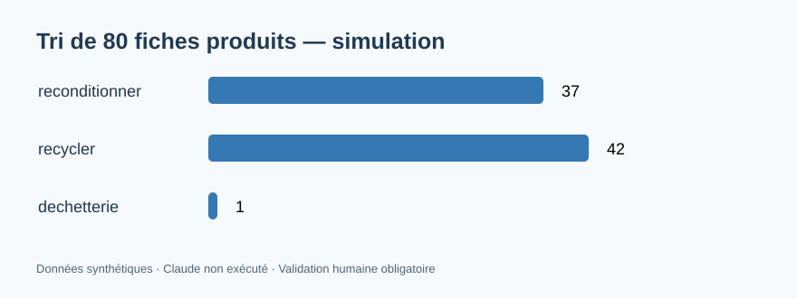

# Agent IA de diagnostic pour le tri de produits — Fédération Envie

Projet **indépendant** de Fédération Envie ; simulation pour démontrer la conception d'un **arbre de décision**, une aide au réemploi, et un agent enrichi par une recherche documentaire **RAG** locale (TF-IDF + similarité). Aucune donnée réelle d'Envie.



## Stack
Python, Claude API (optionnelle), RAG, arbres de décision, scikit-learn, tests unitaires.

## Exécution
```bash
pip install -r requirements.txt
python -m unittest discover -s tests -v
python -m agent.diagnostic_agent
```
Pour générer une suggestion Claude, définir **ANTHROPIC_API_KEY** dans l'environnement, puis `python -m agent.diagnostic_agent --claude` ; clé jamais stockée dans le dépôt. Le modèle est configurable via `CLAUDE_MODEL`.

## Périmètre
- 80 fiches produits avec état, défaut, valeur estimée, décision de référence et tri manuel **simulé**.
- Règle de sécurité prioritaire : défauts à risque → professionnel + filière DEEE, sans procédure de réparation.
- Décision déterministe ; l'IA ne peut jamais déroger aux règles de sécurité ; validation humaine impérative.
- [Rapport et comparaison](output/rapport_diagnostic.md) : résultats sur les fiches de démonstration.

## Tags
IA agentique · aide à la décision · économie circulaire · réemploi · fiches produits · spécifications · algorithme · Python · Claude · RAG
