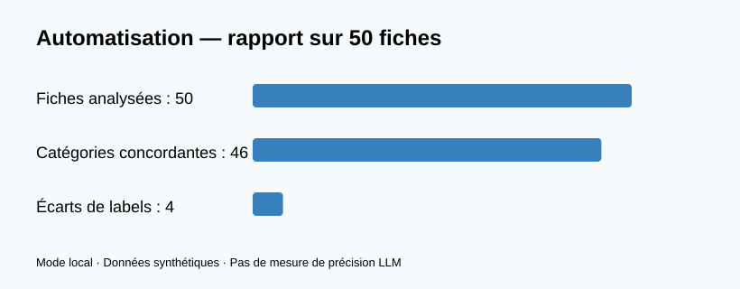

# Automatisation de process — Enrichissement fiches produits + Bot SAV

Projet personnel indépendant de Fédération Envie : **webhook n8n → extraction HTML → enrichissement structuré → insertion SQL** et bot SAV avec FAQ, détection d'intention et escalade. Exemple de **no-code/low-code**, Python, webhooks et API. Aucune donnée ni accès réel Envie.



## Stack
Python, SQL / SQLite, BeautifulSoup, FastAPI, OpenAI API (optionnelle, modèles ChatGPT), n8n (templates JSON), webhooks.

## Tester sans clé API
```bash
pip install -r requirements.txt
python -m unittest discover -s tests -v
python -m code.pipeline
uvicorn code.api:app --reload
```
Lancer le serveur depuis la racine. Routes `/health`, `/api/scrape-demo`, `/api/enrich`, `/api/store`, `/api/support`.

## ChatGPT API
Définir la variable **OPENAI_API_KEY** puis `python -m code.pipeline --openai` ou envoyer `use_llm:true` à `/api/enrich`. Modèle configurable via **OPENAI_MODEL**. Aucune clé dans les fichiers. Les résultats publiés proviennent exclusivement du **mode local**.

## n8n
Importer les JSON de `workflows/` dans n8n. Ajuster `host.docker.internal` et la configuration réseau selon votre hébergement. Les exemples sont des **templates non exécutés dans n8n** et utilisent une fiche exemple fixe : personnaliser avant usage réel. Sécuriser l'API et les webhooks avant exposition publique.

## Rapport
[Rapport sur 50 fiches](output/rapport_automatisation.md), incluant une comparaison de catégories aux étiquettes simulées et un gain de temps hypothétique. **Pas de mesure de précision LLM réelle.**

## Tags
no-code · low-code · automatisation de process · bots · API · économie circulaire · fiches produits · spécifications · ChatGPT · Make · n8n
