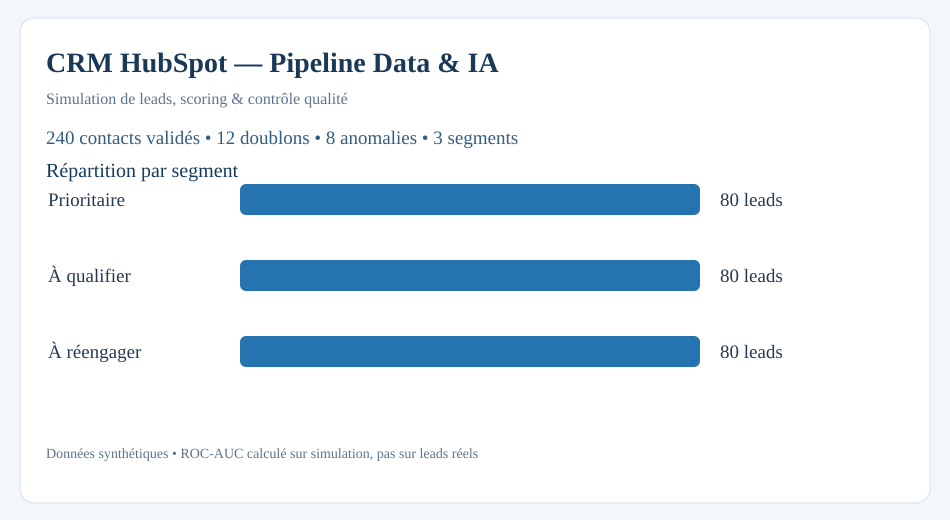

# CRM HubSpot — Pipeline Data & IA de fiabilisation et segmentation

Projet personnel pour un contexte de **génération de leads et marketing digital** : contrôler une base CRM, dédoublonner, fiabiliser, segmenter, calculer les indicateurs commerciaux et proposer un **scoring IA** de qualification. Inspiré des besoins d'un poste de **Chargé(e) de projets Data & IA** ; aucun lien opérationnel avec une entreprise partenaire ou ISCOD.



## Stack

**Python (pandas, scikit-learn), SQL / SQLite, HubSpot API (adaptateur facultatif), segmentation de données, scoring qualité, machine learning, Excel / tableurs avancés, automatisation et tests.**

## Résultats de la simulation

- **260 contacts** en entrée ; **12 doublons**, **8 anomalies**, **240 contacts fiabilisés**.
- **3 segments** de leads déterminés à partir du score ML ; scoring qualité explicable.
- Export SQL en étoile (quatre dimensions), contrôles d'intégrité et rapports par source, secteur, segment et statut.
- Écart de facturation détecté et filtres de livraison paramétrables ; aucune diffusion de contacts réelle.
- Test de classification sur un échantillon de contrôle **synthétique** ; il ne s'agit pas d'une précision vérifiée sur des leads réels.

[Rapport chiffré](output/rapport_performance.md) · [Tableur Excel de pilotage](output/pilotage_crm_tableurs_avances.xlsx) · [Cahier des charges / architecture](docs/ARCHITECTURE.md) · [Guide HubSpot API](docs/HUBSPOT_API.md) · [Mode d'emploi Excel](docs/EXCEL_MODELE.md)

## Reproduire

```bash
python -m pip install -r requirements.txt
PYTHONPATH=src python -m crm_pipeline generate
PYTHONPATH=src python -m unittest discover -s tests -v
PYTHONPATH=src python -m crm_pipeline run
PYTHONPATH=src python -m crm_pipeline.delivery
```

Le projet produit les fichiers `output/contacts_fiabilises_scores.csv`, `output/rejets_audit.csv`, `output/kpi_*.csv`, `output/livraison_client_demo.csv`, `output/resultats.json` et `output/hubspot_demo.sqlite`.

### HubSpot (connexion optionnelle)

`PYTHONPATH=src python -m crm_pipeline hubspot-fixture` est exécutable sans compte. L'adaptateur API **lecture seule** nécessite une clé privée `HUBSPOT_PRIVATE_APP_TOKEN` et n'a pas été testé contre un compte HubSpot réel. La fixture HubSpot se trouve dans `data/hubspot_fixture.json`.

## Méthode du scoring IA

- Modèle **LogisticRegression** avec variables comportementales et contextuelles, encodage des catégories, normalisation des variables numériques.
- Séparation train/test stratifiée (75/25), métriques ROC-AUC et balanced accuracy sur **données de simulation**.
- Pour les besoins de pilotage, trois segments par tertiles de score ; les seuils doivent être validés métier avant toute utilisation réelle.
- L'indicateur à prédire est `contacts_convertis > 0`, qui appartient uniquement au jeu de démonstration et ne figure **pas** parmi les variables d'entrée du modèle.

## Exemples de missions représentées

| Mission | Preuve du projet |
|---|---|
| Fiabilisation du CRM HubSpot | Normalisation, dédoublonnage, audit, fixture et adaptateur API |
| SQL et bases de données relationnelles | Schéma dimensionnel SQLite, contraintes et requêtes métiers |
| Segmentation et scoring de leads | Score qualité, ML, priorité et filtres de livraison |
| Back-office et reporting commercial | Volumes, transformations, coût par lead, marge, litiges, rapprochement factures |
| Intégrations API et automatisation des processus | Interface HubSpot lecture seule, CLI et export client filtré |
| Coordination / spécifications / recette | Documentation d'architecture, tests unitaires et CI GitHub |

## Tags ATS
CRM · HubSpot · bases de données relationnelles · SQL · segmentation · fiabilisation · intelligence artificielle · automatisation des processus · projets Data · Python · tableurs avancés · Excel · API · reporting et pilotage de la performance

**Données fictives uniquement**, adresses `example.com`. Aucun jeton, contact réel, export client réel ou résultat d'entreprise n'est utilisé.
