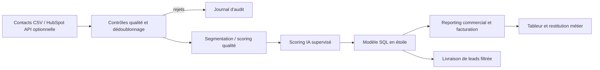

# Architecture fonctionnelle — projet Data & IA

## Besoin métier traité
1. **Fiabiliser** le CRM (unicité des e-mails, dates, valeurs et volumes cohérents).
2. **Segmenter** les contacts selon trois niveaux de priorité et mesurer la qualité.
3. **Automatiser** les exports pour l’équipe commerciale et limiter les contrôles manuels répétitifs.
4. **Piloter** le nombre de leads livrés, leur transformation, le coût par lead, les marges et les litiges.
5. **Assister** la qualification des leads avec un modèle ML explicable et testable sur données synthétiques.

## Spécifications / recette
- 260 lignes sources dont 12 doublons contrôlés et 8 autres anomalies.
- 240 contacts uniques exploitables en sortie (seuil de qualité et filtres de livraison configurables).
- Score qualité sur 100 avec pénalités explicites, modèle de classification test/train reproductible.
- Rapport de facturation basé sur `montant_facture - ca_facture` ; écarts signalés et non corrigés automatiquement.
- Base SQLite créée de zéro à chaque exécution, contraintes SQL, contrôles d’intégrité.
- Envoi à un client **non implémenté** : uniquement un export CSV de démonstration.

## Sécurité et conformité
Pas de données personnelles réelles, pas de connexion en production, pas d’envoi de leads. En production : RGPD, minimisation, traçabilité, contrôle des droits, masquage des données, consentements et politique de conservation sont indispensables.
