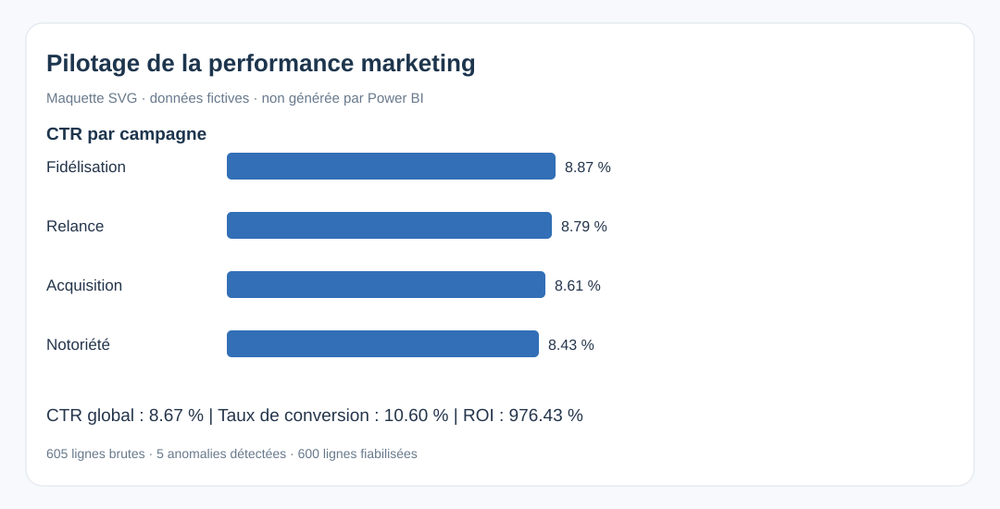

# Tableau de bord de pilotage de la performance marketing

Projet personnel en **analyse de données**, **Business Intelligence** et **aide à la décision**. Pipeline de contrôle qualité, indicateurs clés, études d'impact descriptives des campagnes, modèle en étoile SQL et kit Power BI.



## Résultats vérifiables
- 605 lignes brutes et **5 anomalies** introduites volontairement ; **600 lignes fiabilisées**.
- CTR calculé par ratio des sommes, ROI calculé à partir des dépenses et revenus, taux de conversion sur les clics.
- Comparaison par campagne, segment et canal pour le **pilotage opérationnel**.
- [Rapport d'impact](output/rapport_impact.md) établi sur les données synthétiques.

## Stack
Python (pandas), SQL (SQLite), Power BI (mesures DAX et guide), Jupyter, tests unittest.

## Démarrer
```bash
python -m pip install -r requirements.txt
python pipeline.py
python -m unittest -v
jupyter notebook notebooks/01_ingestion_et_ia.ipynb
```
Lancer Jupyter depuis **la racine du dépôt**. Les exports sont générés dans `output/`.

## Power BI
Le kit contient les [mesures DAX](powerbi/mesures.dax) et les [instructions Power BI Desktop](powerbi/INSTRUCTIONS_POWER_BI.md). La maquette affichée est un **aperçu SVG** : le dépôt ne prétend pas contenir de fichier .pbix créé dans Power BI Desktop.

## Structure
- `data/campagnes_demo.csv` — 605 observations fictives
- `pipeline.py` — ingestion, fiabilisation, indicateurs et SQLite
- `notebooks/` — exploration et analyse d'impact par campagne / segment
- `models/model_star_schema.sql` — modèle de données en étoile
- `powerbi/` — guide et mesures DAX
- `output/rapport_impact.md` — synthèse chiffrée
- `assets/` — maquette de dashboard

## Tags
analyse de données · Business Intelligence · aide à la décision · pilotage opérationnel · indicateurs clés · bases de données · campagnes marketing · études d'impact

**Aucune donnée réelle de France Travail ou d'employeur.** Les comparaisons de campagnes ne permettent pas d'établir une causalité.
