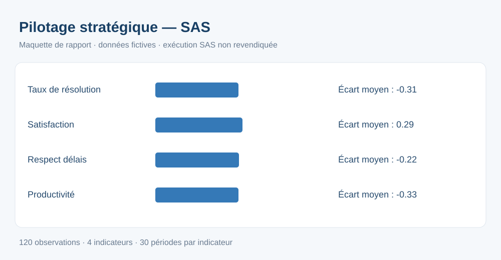

# Pipeline d'analyse de performance — SAS

Projet pédagogique de **statistiques** et **pilotage stratégique** : import et contrôle de données synthétiques, calcul des écarts aux cibles, test de signification (TTEST) et ANOVA avec SAS.

## Résultats et données
- **120 observations fictives**, réparties entre 4 KPI sur 30 périodes.
- Calcul des écarts entre **valeur observée** et **cible**.
- Rapport d'aperçu indépendant : [output/apercu_rapport.html](output/apercu_rapport.html).

## Stack
SAS Studio / SAS 9.4 : **PROC IMPORT, DATA step, PROC MEANS, PROC TTEST, PROC GLM (ANOVA), PROC REPORT, ODS HTML**.

## Exécuter sous SAS
1. Importer ce dossier dans SAS Studio.
2. Modifier `%let BASE=.;` dans [le script SAS](sas/01_analyse_performance.sas) afin de pointer vers le dossier contenant `data/` et `output/`.
3. Créer le dossier `output/` si nécessaire puis exécuter le script.
4. Le rapport natif SAS sera écrit dans `output/rapport_sas_execute.html`.

**Le programme SAS n'a pas été exécuté dans cet environnement.** L'aperçu HTML et SVG est produit indépendamment et ne constitue pas un résultat de SAS.

## Méthode
Le test t bilatéral par KPI vérifie si l'écart moyen à la cible diffère de zéro. L'ANOVA des écarts entre KPI aux unités différentes reste purement pédagogique : elle n'autorise pas une conclusion métier comparative.

## Tags
pilotage stratégique · aide à la décision · statistiques · analyse de données · indicateurs clés

Aucune donnée réelle de France Travail ou d'un employeur.
