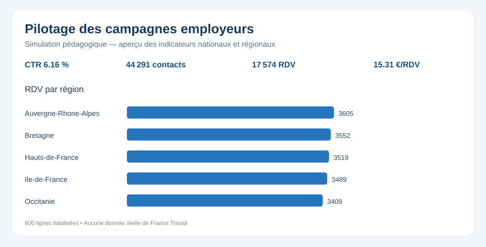

# Pilotage stratégique et opérationnel — campagnes France Travail Pro (simulation)

Projet de portefeuille **Data Analyst / Business Intelligence** reproduisant un cas de pilotage marketing : conception d'une base décisionnelle, qualité et fiabilisation, suivi des campagnes à l'échelle nationale et locale, analyses par secteur, études d'impact et restitutions aux directions métier.



**[Ouvrir le tableau de bord HTML interactif](output/dashboard_campagnes.html)** · **[Lire le rapport d'impact](output/rapport_impact.md)** · **[Cahier des charges](docs/cahier_des_charges.md)**

## Stack et livrables

| Technologie | Réalisation |
|---|---|
| **Python / pandas** | Audit qualité, fiabilisation de 605 lignes en 600, KPI par région/secteur/campagne, étude d'impact descriptive et exports |
| **SQL / SQLite** | Modèle en étoile (six dimensions, table de faits), index, requêtes territoriales et sectorielles |
| **SAS** | PROC IMPORT, DATA step, PROC SQL, macros, PROC MEANS, PROC TTEST, PROC GLM/ANOVA, PROC REPORT, ODS PDF/HTML |
| **R** | Statistiques descriptives, test t, régression avec interaction exposé × après, analyses sectorielles |
| **Power BI** | Schéma relationnel, mesures DAX, maquettes de 4 pages et guide d'import dans Power BI Desktop |
| **HTML/CSS/JavaScript** | Tableau de bord autonome filtrable : Région, Secteur, Campagne, Période |

## Scénario métier

Un service marketing souhaite mesurer la performance de campagnes employeurs, comprendre les disparités territoriales et sectorielles, comparer des cohortes exposées/témoins et aider les directions à décider quels indicateurs suivre. Les données sont **entièrement synthétiques** ; elles ne proviennent pas de France Travail.

- **5 régions**, **5 secteurs**, **3 campagnes**, **8 semaines**.
- **605 lignes sources**, dont 1 doublon et 4 anomalies ; **600 lignes exploitables**.
- Parcours : impressions → clics → contacts → rendez-vous, budget et coût par rendez-vous.
- Différence de différences **descriptive** (non causale) exposés/témoins avant/après.

## Démarrer et reproduire les indicateurs

Lancer les commandes depuis la racine de ce dossier :

```bash
python -m pip install -r requirements.txt
python -m unittest discover -s tests -v
python python/pipeline_marketing.py
```

Les résultats sont créés dans le dossier `output/` : CSV contrôlés, tables dimensionnelles, base `pilotage_campagnes.sqlite`, synthèse JSON, sorties par région et secteur. Le pipeline est conçu pour être relancé sans écraser le jeu de données source.

### Analyses statistiques avec SAS et R

- SAS Studio : adapter la variable `ROOT` dans [sas/02_campagnes_ft_pro.sas](sas/02_campagnes_ft_pro.sas), puis exécuter pour générer PDF/HTML, audit, exports et tests statistiques.
- R : exécuter `Rscript r/analyse_impact.R .` ; les tableaux et résultats statistiques sont exportés dans `output/`.
- Ces deux scripts nécessitent SAS Studio / SAS 9.4 et R respectivement. **Ils n'ont pas été exécutés dans cet environnement** ; leur exécution ne doit pas être présumée.

### Power BI

[Guide Power BI Desktop](powerbi/guide_powerbi.md) · [Mesures DAX](powerbi/mesures.dax). Le dépôt fournit les exports et les mesures, **mais pas de fichier .pbix/.pbit natif** : l'aperçu SVG et le tableau de bord HTML ne sont pas des captures Power BI.

## Correspondance aux missions de l'offre France Travail 2026-90734

| Mission cible | Preuve dans le projet |
|---|---|
| Mobiliser SAS, R, Python, Power BI pour l'aide à la décision | Scripts SAS/R, pipeline pandas, mesures DAX |
| Concevoir et faire évoluer bases et tableaux de bord | SQL étoile, exports, dashboard HTML filtrable, guide Power BI |
| Réaliser des études d'impact marketing et sectorielles | Analyse exposés/témoins, différences avant/après, indicateurs par secteur |
| Suivre les campagnes localement et nationalement | KPI par région, secteur, campagne, semaine, filtres interactifs |
| Restituer indicateurs clés aux directions métier | [Rapport d'impact](output/rapport_impact.md), [cahier des charges](docs/cahier_des_charges.md), dashboard |

Voir la [fiche officielle de l'offre](https://recrute.francetravail.org/offre-de-emploi/emploi-apprentissage-charge-e-d-analyse-de-donnees-de-pilotage_90734.aspx).

## Projet SAS initial conservé

L'ancien mini-projet de 120 observations demeure accessible via [data/performance_demo.csv](data/performance_demo.csv) et [sas/01_analyse_performance.sas](sas/01_analyse_performance.sas). La simulation de campagnes (605/600) est un **cas d'usage complémentaire**, avec un périmètre plus complet.

## Limites méthodologiques

Les tests t et régressions proposés illustrent la démarche d'analyse, mais ne démontrent pas un effet de campagne réel. Toute conclusion causale exigerait un protocole adapté, une comparaison des tendances pré-intervention, un contrôle des biais de sélection et des données réelles autorisées.

**Tags :** SAS · R · Python · Power BI · SQL · statistiques · analyse de données · Business Intelligence · pilotage stratégique · pilotage opérationnel · indicateurs clés · campagnes France Travail Pro · études d'impact · aide à la décision
