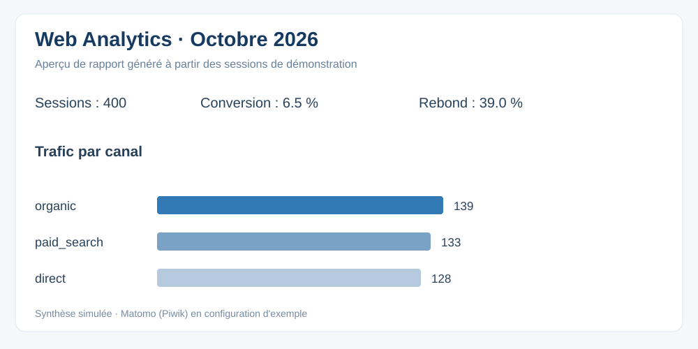

# Web Analytics & SEO Audit — Matomo (Piwik), Python et benchmarking

Étude de cas indépendante pour démontrer le **web analytics**, le **SEO** on-page et off-page, un plan de **tracking** (Piwik/Matomo), l'analyse du **parcours client**, des **taux de conversion** et un **rapport d'analyse mensuel**. Les données, noms de domaines, positions et backlinks sont entièrement simulés ; aucun chiffre réel d'Arkema ou de concurrents.



**[Ouvrir le tableau de bord mensuel HTML](output/dashboard.html)** · **[Lire le rapport mensuel](output/rapport_mensuel_2026-10.md)** · **[Audit SEO](output/audit_seo.md)** · **[Benchmark concurrentiel](output/benchmark.md)**

## Livrables

- **720 sessions simulées** sur septembre/octobre 2026, **3 sources de trafic** (organic / paid_search / direct).
- **131 pages** : une page d'accueil + 130 articles HTML reliés entre eux, sitemap du jeu de données inclus.
- Un **site de démonstration HTML** avec événements `trackPageView`, `trackEvent` (CTA) et `trackGoal` (demande de contact) sur instance Matomo (anciennement Piwik) configurable.
- Un **crawler SEO Python** exécuté localement pour les titles, méta data, canonical, H1, architecture des sites web, attributs alt et maillage interne.
- Un **benchmarking de 4 concurrents fictifs**, trafic estimé, positions SEO et backlinks fictifs, pour expliquer les précautions d'interprétation des métriques off-page.
- Un **rapport mensuel** : trafic, taux de conversion (leads/sessions), bounce rate (sessions à une page), pages vues et durée moyenne ; analyses par source de trafic.
- Un **plan de taggage**, une roadmap UX/SEO et des tickets de recette pour le travail transversal avec les développeurs et webmasters.

## Démarrage — Python 3.10+, aucune dépendance externe

```bash
python -m scripts.generate_demo
python -m scripts.monthly_report
python -m scripts.seo_audit
python -m scripts.benchmark
python -m scripts.build_dashboard
python -m unittest discover -s tests -v
python -m http.server 8000 --directory demo
```

Visiter `http://localhost:8000/` pour découvrir le site. Les pages HTML sont générées dans `demo/pages` ; les chiffres sont consultables dans `output/dashboard.html` (ouvrir directement le fichier). Les scripts utilisent uniquement la bibliothèque standard Python. Pour l'audit SEO, le crawler se limite aux pages locales générées et n'accède pas à des sites réels.

## Matomo (Piwik) : tracking et confidentialité

Le tracking est **désactivé par défaut**. Ouvrir `demo/index.html`, définir dans sa configuration `window.MATOMO_CONFIG={baseUrl:'https://votre-matomo.exemple/',siteId:1}` (votre propre instance), puis donner un consentement explicite dans la page pour activer les appels `matomo.js`/`matomo.php`. Le site de démo fonctionne sans Matomo ; il n'envoie alors aucune donnée analytique externe. Le but de conversion est l'objectif n°1 (à configurer dans votre Matomo). Ne jamais utiliser d'identifiants de visiteurs ou d'emails dans des événements.

Documentation officielle : [guide JavaScript Matomo](https://developer.matomo.org/guides/tracking-javascript-guide).

**Content Square (Contentsquare) :** l'offre Arkema le cite pour la compréhension des parcours UX ; ce dépôt illustre le même type d'analyse sur des données synthétiques mais n'intègre pas cette plateforme propriétaire. **Google Analytics :** non connecté, aucun accès prétendu.

## SEO et benchmarking

- **On-page** : title, meta description, canonical, H1, alt, maillage interne et architecture des pages.
- **Off-page** : positions et backlinks fictifs pour expliciter une méthode de benchmarking ; le script ne prétend pas les mesurer sur internet.
- **SEO / SEA** : canaux organique et paid_search, suivi de l'acquisition et de la génération de prospects, sans confusion entre CTR publicitaire et taux de conversion du site.
- **UX** : analyse du tunnel, hypothèses de points de friction et test A/B documenté dans la roadmap.

## Tags

web analytics · SEO · référencement naturel · Content Square · Piwik · Matomo · tracking · parcours client · taux de conversion · trafic · benchmarking · on-page · off-page · méta data · HTML · génération de prospects · indicateurs clés · rapports d'analyse · UX · SEA · digital

## Limites

Projet personnel sur **données de démonstration**. Les indicateurs de sessions et de prospects sont simulés. Le tracking ne produit de véritables mesures Matomo que si un site et une instance administrée sont configurés. Le benchmark ne contient aucun chiffre réel de trafic ni aucun backlink observé. Les recommandations sont illustratives.
